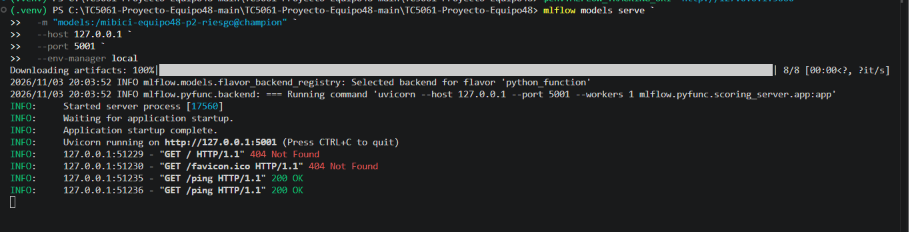
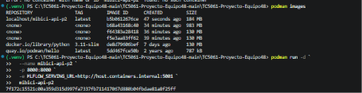
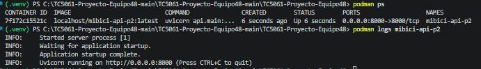
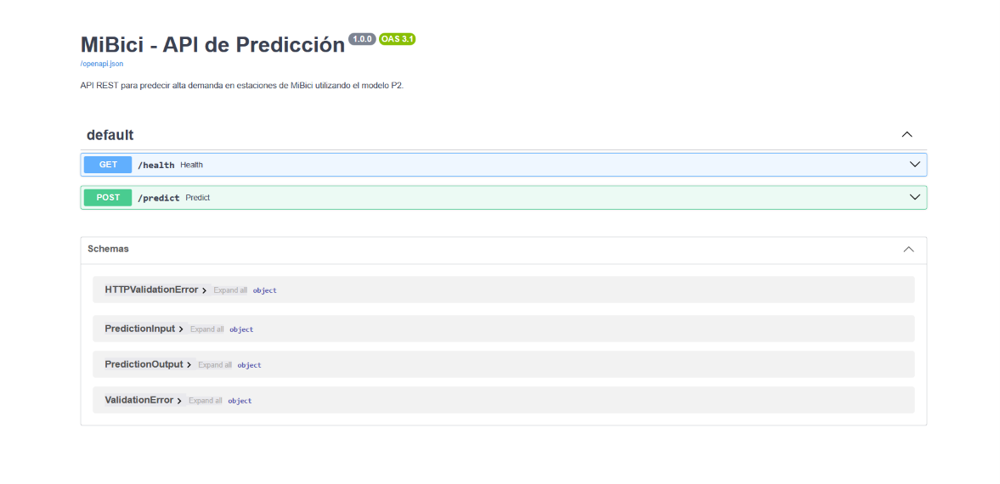
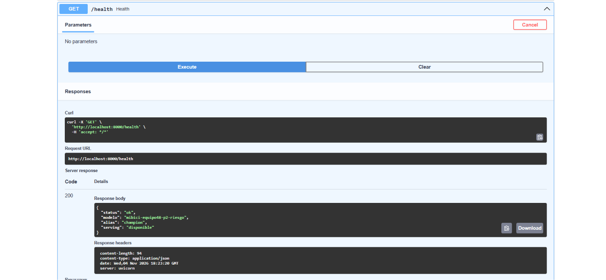
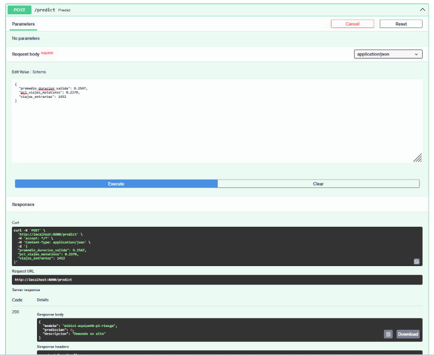

# Despliegue del modelo P2 mediante FastAPI y Podman

## 1. Descripción general

Como parte del proyecto MiBici, se implementó un servicio REST para realizar predicciones de alta demanda en estaciones del sistema de bicicletas públicas.

La solución utiliza el modelo de clasificación P2, registrado en MLflow Model Registry, y permite consultar sus predicciones mediante una API desarrollada con FastAPI y desplegada en un contenedor OCI compatible mediante Podman.

La arquitectura está integrada por dos servicios independientes:

1. **MLflow Model Serving:** publica el modelo registrado y recibe solicitudes de inferencia.
2. **FastAPI:** expone endpoints REST, valida los datos de entrada y envía las solicitudes al servicio de MLflow.

FastAPI funciona como intermediario entre el cliente y el modelo de aprendizaje automático.

## 2. Arquitectura de despliegue

La solución implementada utiliza la siguiente arquitectura:

```text
                  CLIENTE
                     |
                     |
              HTTP Request
                     |
                     v
          +----------------------+
          |       FastAPI        |
          |   Contenedor Podman  |
          |                      |
          |      Puerto 8000     |
          |                      |
          |  GET  /health        |
          |  POST /predict       |
          +----------------------+
                     |
                     |
              HTTP Request
                     |
                     v
          +----------------------+
          |  MLflow Model        |
          |      Serving         |
          |                      |
          |     Puerto 5001      |
          |                      |
          |    /ping             |
          |    /invocations      |
          +----------------------+
                     |
                     v
          +----------------------+
          |     Modelo P2        |
          |                      |
          |  mibici-equipo48-    |
          |  p2-riesgo            |
          |                      |
          |  Alias: champion     |
          +----------------------+
```

### Flujo de predicción

1. El cliente envía una solicitud HTTP al endpoint `/predict` de FastAPI.
2. FastAPI valida los datos recibidos mediante modelos de Pydantic.
3. Se construye una solicitud en formato `dataframe_split`.
4. FastAPI envía los datos al endpoint `/invocations` de MLflow Model Serving.
5. MLflow ejecuta el modelo P2 y devuelve la predicción.
6. FastAPI procesa el resultado y responde al cliente en formato JSON.

## 3. Modelo utilizado

El servicio utiliza el modelo de clasificación P2 registrado en MLflow Model Registry.

| Propiedad | Valor |
|---|---|
| Nombre del modelo | `mibici-equipo48-p2-riesgo` |
| Alias | `champion` |
| Tipo de problema | Clasificación |
| Variable objetivo | `alta_demanda` |
| Clase 0 | Demanda no alta |
| Clase 1 | Alta demanda |

### Variables de entrada

El modelo recibe las siguientes características:

| Variable | Descripción |
|---|---|
| `promedio_duracion_salida` | Duración promedio de los viajes de salida. |
| `pct_viajes_matutinos` | Proporción de viajes realizados durante la mañana. |
| `viajes_entrantes` | Cantidad de viajes entrantes a la estación. |

## 4. Estructura de archivos

La implementación utiliza la siguiente estructura:

```text
TC5061-Proyecto-Equipo48/
│
├── api/
│   ├── main.py
│   └── requirements.txt
│
├── Containerfile
│
├── requirements.txt
│
└── README.md
```

### Descripción de los archivos

- **api/main.py:** contiene la implementación de FastAPI, los esquemas de validación y los endpoints `/health` y `/predict`.
- **api/requirements.txt:** contiene las dependencias necesarias para ejecutar la API.
- **Containerfile:** define la construcción de la imagen del contenedor.
- **requirements.txt:** conserva las dependencias generales del proyecto.

## 5. Tecnologías utilizadas

- Python 3.11
- FastAPI
- Uvicorn
- Pydantic
- Requests
- MLflow Model Serving
- Podman
- Docker/OCI compatible Containerfile

## 6. Configuración del entorno

Para ejecutar la solución se requiere:

- Python 3.11.
- MLflow instalado en el entorno donde se ejecutará Model Serving.
- Podman instalado y funcionando.
- Modelo P2 registrado en MLflow Model Registry.
- Acceso a los artefactos del modelo registrados en MLflow.

## 7. Ejecución de MLflow Model Serving

MLflow Model Serving se ejecuta fuera del contenedor Podman, en el equipo anfitrión.

Desde una terminal con el entorno Python del proyecto activado, ejecutar:

```powershell
mlflow models serve `
  -m "models:/mibici-equipo48-p2-riesgo@champion" `
  --host 0.0.0.0 `
  --port 5001 `
  --env-manager local
```

Descripción de los parámetros:

- `-m`: especifica el modelo registrado en MLflow Model Registry.
- `@champion`: indica el alias del modelo que se desea utilizar.
- `--host 0.0.0.0`: permite que el servicio acepte conexiones desde otras interfaces de red.
- `--port 5001`: establece el puerto del servicio.
- `--env-manager local`: utiliza el entorno Python local para ejecutar el modelo.

Mantener esta terminal abierta mientras se utiliza la API.

### Verificación de disponibilidad

Desde otra terminal ejecutar:

```powershell
curl.exe http://127.0.0.1:5001/ping
```

La respuesta esperada es:

```text
pong
```

Este endpoint permite comprobar que MLflow Model Serving está disponible.

## 8. Construcción de la imagen con Podman

El archivo `Containerfile` contiene las instrucciones para construir la imagen de la API.

Contenido:

```dockerfile
FROM python:3.11-slim

WORKDIR /app

COPY api/requirements.txt .

RUN pip install --no-cache-dir -r requirements.txt

COPY api/ ./api/

EXPOSE 8000

CMD ["uvicorn", "api.main:app", "--host", "0.0.0.0", "--port", "8000"]
```

Para construir la imagen, ubicarse en el directorio raíz del repositorio y ejecutar:

```powershell
podman build -t mibici-api-p2 -f Containerfile .
```

Descripción:

- `podman build`: construye una imagen de contenedor.
- `-t mibici-api-p2`: asigna el nombre a la imagen.
- `-f Containerfile`: especifica el archivo de construcción.
- `.`: indica el contexto de construcción, correspondiente al directorio actual.

Para comprobar que la imagen fue creada:

```powershell
podman images
```

## 9. Ejecución del contenedor

Una vez construida la imagen, ejecutar:

```powershell
podman run -d `
  --name mibici-api-p2 `
  -p 8000:8000 `
  -e MLFLOW_SERVING_URL=http://host.containers.internal:5001 `
  mibici-api-p2
```

Descripción de los parámetros:

- `-d`: ejecuta el contenedor en segundo plano.
- `--name`: asigna el nombre `mibici-api-p2`.
- `-p 8000:8000`: publica el puerto 8000 del contenedor en el equipo anfitrión.
- `-e MLFLOW_SERVING_URL`: configura la dirección del servicio MLflow.
- `host.containers.internal`: permite que el contenedor Podman acceda al equipo anfitrión.

**Importante:** dentro del contenedor, `localhost` hace referencia al propio contenedor. Por esta razón se utiliza `host.containers.internal` para comunicarse con MLflow Model Serving, que se ejecuta en el equipo anfitrión.

### Verificar el contenedor

Para comprobar que el contenedor está ejecutándose:

```powershell
podman ps
```

Para consultar los registros:

```powershell
podman logs mibici-api-p2
```

## 10. Endpoints disponibles

FastAPI expone dos endpoints principales.

### 10.1 GET /health

Permite verificar la disponibilidad de MLflow Model Serving.

**Solicitud:**

```http
GET http://localhost:8000/health
```

**Respuesta esperada:**

```json
{
  "status": "ok",
  "modelo": "mibici-equipo48-p2-riesgo",
  "alias": "champion",
  "serving": "disponible"
}
```

Si MLflow Model Serving no está disponible, la API devuelve un error HTTP 503.

### 10.2 POST /predict

Permite realizar predicciones de alta demanda utilizando el modelo P2.

**Solicitud:**

```http
POST http://localhost:8000/predict
Content-Type: application/json
```

**Datos de entrada:**

```json
{
  "promedio_duracion_salida": 9.2547,
  "pct_viajes_matutinos": 0.2379,
  "viajes_entrantes": 1452
}
```

**Respuesta obtenida en la prueba:**

```json
{
  "modelo": "mibici-equipo48-p2-riesgo",
  "prediccion": 0,
  "descripcion": "Demanda no alta"
}
```

El valor de la predicción depende de las características proporcionadas al modelo.

## 11. Validación de datos

La API utiliza Pydantic para validar las variables de entrada antes de enviarlas al modelo.

Se establecen las siguientes restricciones:

| Variable | Validación |
|---|---|
| `promedio_duracion_salida` | Valor numérico mayor o igual a cero. |
| `pct_viajes_matutinos` | Valor numérico entre 0 y 1. |
| `viajes_entrantes` | Valor numérico mayor o igual a cero. |

Si los datos no cumplen las restricciones, FastAPI devuelve un error HTTP 422 (Unprocessable Entity).

Además, se manejan errores de comunicación con MLflow mediante respuestas HTTP 503 y errores de respuesta del servicio mediante HTTP 502.

## 12. Documentación interactiva y pruebas

FastAPI genera automáticamente una documentación interactiva mediante Swagger UI.

Una vez iniciado el contenedor, acceder desde el navegador a:

http://localhost:8000/docs

Desde esta interfaz es posible:

- Consultar los endpoints disponibles.
- Revisar los esquemas de entrada y salida.
- Ejecutar solicitudes HTTP.
- Introducir datos de prueba.
- Consultar las respuestas del modelo.

Para comprobar el funcionamiento completo se realizaron pruebas de los endpoints `/health` y `/predict`.

En la prueba de predicción se obtuvo una respuesta HTTP 200, confirmando la comunicación entre FastAPI y MLflow Model Serving y la ejecución del modelo P2.

## 13. Estrategia de despliegue

Se implementó una estrategia de inferencia en tiempo real (*online inference*).

El cliente envía los datos de una estación mediante una solicitud HTTP y recibe una predicción inmediatamente, sin necesidad de esperar a un procesamiento por lotes.

La solución separa las responsabilidades:

- MLflow Model Serving se encarga de ejecutar el modelo.
- FastAPI gestiona las solicitudes, valida los datos y estructura las respuestas.
- Podman permite empaquetar y ejecutar la API en un contenedor reproducible.

Esta separación facilita actualizar el modelo o la API de manera independiente.

## 14. Detener y eliminar el contenedor

Para detener el servicio:

```powershell
podman stop mibici-api-p2
```

Para eliminar el contenedor:

```powershell
podman rm mibici-api-p2
```

Para eliminar la imagen:

```powershell
podman rmi mibici-api-p2
```

Para volver a ejecutar la solución, primero iniciar MLflow Model Serving y posteriormente construir o ejecutar el contenedor de FastAPI, según corresponda.

## 15. Resultado del despliegue

Se logró desplegar una API REST desarrollada con FastAPI dentro de un contenedor Podman, integrándola con MLflow Model Serving para ejecutar el modelo de clasificación P2.

La implementación permite recibir datos de estaciones, validarlos, enviarlos al modelo registrado en MLflow y devolver predicciones en formato JSON.

La prueba realizada mediante Swagger UI obtuvo una respuesta HTTP 200 y una predicción válida, demostrando el funcionamiento de la integración entre los servicios.

## 16. Evidencias del despliegue

### 16.1 MLflow Model Serving



### 16.2 Imagen construida con Podman



### 16.3 Contenedor en ejecución



### 16.4 Documentación de FastAPI



### 16.5 Prueba del endpoint Health



### 16.6 Predicción del modelo

