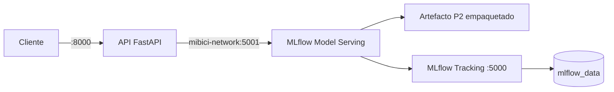

# Orquestación local con Docker Compose

## Objetivo

`compose.yaml` inicia la arquitectura operativa de P2 con un comando. Contiene
tres servicios: seguimiento de MLflow, serving del modelo P2 y la API FastAPI.



`model-serving` sirve el artefacto local `models/p2`, descargado previamente
desde MLflow Model Registry. Esto hace reproducible el despliegue local sin
depender de que el registro remoto contenga un modelo al iniciar los servicios.

## Modos de serving de la API

La misma imagen funciona de dos formas, según la variable `MLFLOW_SERVING_URL`:

| Modo | Cuándo | Comportamiento |
|---|---|---|
| `remoto` | `MLFLOW_SERVING_URL` definida (Compose la define) | La API valida la solicitud y la reenvía por HTTP a `model-serving`. |
| `local` | Variable ausente o vacía (`docker run` de la Semana 8) | La API carga `models/p2` con `mlflow.pyfunc` en su propio proceso. |

`GET /health` indica el modo activo en el campo `modo`. Así se conserva el
despliegue de un solo contenedor documentado en
[api/README_API_macOS.md](../api/README_API_macOS.md).

## Servicios

| Servicio | Puerto publicado | Responsabilidad |
|---|---:|---|
| `api` | 8000 | Valida solicitudes y reenvía predicciones a MLflow Model Serving. |
| `model-serving` | No se publica | Sirve el modelo P2 dentro de la red interna. |
| `mlflow` | 5000 | Expone tracking y conserva su backend SQLite y artefactos. |

La red `mibici-network` permite que la API use
`http://model-serving:5001`, sin depender de `localhost` ni de puertos del
equipo anfitrión. El volumen nombrado `mlflow_data` conserva la base de datos y
los artefactos aun si los contenedores se recrean.

El servidor de tracking restringe los encabezados `Host` a `mlflow`, `localhost`
y `127.0.0.1` (en cualquier puerto, con el patrón `host:*`), que cubren la
comunicación interna y el acceso local al panel aunque se cambie `MLFLOW_PORT`.

> **macOS:** el puerto 5000 suele estar ocupado por *AirPlay Receiver*
> (proceso `ControlCenter`). Si `docker compose up` falla con
> `address already in use`, publica MLflow en otro puerto:
> `MLFLOW_PORT=5050 docker compose up --build -d` (o define `MLFLOW_PORT=5050`
> en `.env`) y abre `http://localhost:5050`.

## Ejecución

1. Inicia Docker Desktop y confirma que el daemon responda:

   ```bash
   docker info
   ```

2. Opcionalmente, copia `.env.example` a `.env` y ajusta los puertos.

3. Construye e inicia todos los servicios:

   ```bash
   docker compose up --build -d
   docker compose ps
   ```

4. Confirma comunicación API–MLflow:

   ```bash
   curl -i http://localhost:8000/health
   curl -i -X POST http://localhost:8000/predict \
     -H 'Content-Type: application/json' \
     -d '{"promedio_duracion_salida":9.25,"pct_viajes_matutinos":0.24,"viajes_entrantes":1452}'
   ```

Una respuesta HTTP 200 en `/health` requiere que la API alcance
`model-serving`; por tanto, verifica la comunicación interna y no solo que el
contenedor FastAPI esté encendido.

## Diagnóstico y apagado

```bash
docker compose logs --follow
docker compose logs api model-serving mlflow
docker compose down
```

`docker compose down` elimina contenedores y red, pero conserva `mlflow_data`.
Usa `docker compose down --volumes` solo cuando se quiera eliminar el estado
persistido de MLflow.

## Verificación de configuración

Antes de iniciar Docker, se puede revisar la configuración resuelta sin crear
contenedores:

```bash
docker compose --env-file .env.example config
```
