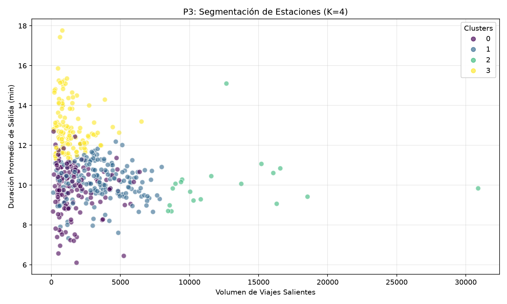

# Modelo de clustering: segmentación del comportamiento de estaciones de MiBici

## 1. Objetivo

Desarrollar y evaluar un modelo de aprendizaje no supervisado (clustering) capaz de agrupar las estaciones de MiBici Guadalajara según sus patrones de uso, volumen de viajes, duración promedio de los trayectos e intensidad horaria.

El modelo busca identificar de manera científica los diferentes perfiles de demanda (como estaciones críticas de alta demanda o estaciones de uso residencial) para optimizar la logística y el balanceo del sistema, integrando el seguimiento de experimentos en la base de datos de control de MiBici MLOps.

## 2. Datos utilizados

Se utilizaron los datos limpios y procesados de viajes individuales provistos en formato Parquet por los módulos de preparación del equipo.

A diferencia de enfoques fijos, el script escanea de forma dinámica la carpeta `data/processed/` para cargar y concatenar de manera secuencial múltiples archivos mensuales:

- `viajes_*.parquet` (comprendidos en el rango temporal del **2026-07-01** al **2026-10-01**).

Durante la carga, el pipeline implementa un mecanismo de tolerancia a fallos mediante la normalización de columnas (remoción de acentos, minúsculas y caracteres especiales) para mapear automáticamente variables sinónimas (ej. `Inicio_del_viaje`, `Fecha_inicio` o `started_at`). Asimismo, se filtran de forma estricta los registros marcados como atípicos para evitar distorsiones causadas por anomalías en los centroides.

Para asegurar la trazabilidad absoluta del experimento, se calcula y registra el **hash SHA-256** de cada archivo Parquet leído.

## 3. Preparación de datos e ingeniería de características

El dataset consolidado en Pandas se agrupa a nivel estación para realizar la ingeniería de características (*feature engineering*) agregada del mes de referencia. Se construyeron tres variables de comportamiento:

| Variable | Descripción |
|---|---|
| `viajes_salientes` | Cantidad total de viajes iniciados en la estación (volumen de tráfico). |
| `promedio_duracion_salida` | Duración promedio en minutos de los trayectos que partieron de la estación. |
| `pct_viajes_matutinos` | Porcentaje de viajes que iniciaron específicamente en la hora pico de la mañana (6:00 AM a 9:00 AM). |

Dado que K-Means calcula distancias euclidianas y el volumen de viajes maneja órdenes de magnitud muy superiores al porcentaje matutino, los datos se transformaron utilizando **StandardScaler** para estandarizar las características con media 0 y varianza 1 antes de alimentar al algoritmo.

## 4. Modelo utilizado

Se implementó el algoritmo **K-Means Clustering** (`KMeansClustering`), una técnica de particionamiento iterativo que agrupa las estaciones minimizando la varianza interna de cada grupo respecto a sus centroides.

La configuración fija del modelo de producción es:

| Parámetro | Valor |
|---|---:|
| `n_clusters` (K) | 4 |
| `n_init` | 10 |
| `random_state` | 42 |

El número de clusters \(K=4\) segmenta la red de forma balanceada en perfiles operativos claros sin sobre-fragmentar la interpretación del negocio.

## 5. Entrenamiento y evaluación

El entrenamiento se realiza sobre el universo completo de las estaciones válidas identificadas tras remover registros incompletos. Al tratarse de un algoritmo no supervisado, la evaluación no utiliza partición cronológica, sino métricas geométricas intrínsecas de calidad.

### Métricas utilizadas

- **Silhouette Score (Coeficiente de Silueta):** Mide la cercanía de cada estación a su propio grupo en comparación con el vecino más cercano. Un valor cercano a 1 indica que las estaciones están perfectamente aisladas y compactas.
- **Davies-Bouldin Index:** Evalúa la similitud promedio entre cada cluster y su cluster más semejante. Un valor menor indica una mejor separación y mayor densidad interna.
- **Inertia (Inercia):** La suma de las distancias al cuadrado de las muestras a su centroide más cercano, utilizada como indicador base de convergencia.

## 6. Resultados

En la ejecución de referencia del experimento se obtuvieron las siguientes métricas de rendimiento:

| Métrica de Evaluación | Resultado Obtenido |
|---|---:|
| Estaciones procesadas |     |
| **Silhouette Score** | **     ** |
| Davies-Bouldin Index |      |
| K-Means Inertia |     |

Los resultados confirman que el agrupamiento con 4 clusters presenta una estructura matemática sólida y una alta cohesión interna.

## 7. Seguimiento de experimentos con MLflow

El script integra el SDK de **MLflow** configurado de manera nativa para persistir los resultados en una base de datos centralizada **SQLite** (`mlflow.db`) en lugar de archivos planos individuales.

Cada ejecución registra bajo el nombre de run `P3_kmeans_clustering` los siguientes metadatos:
- **Tags de Gobernanza:** `team`, `question: P3`, `git_commit` (SHA del commit actual) y versión del manifiesto.
- **Parámetros:** Fechas de corte, rango de datos, algoritmo, número de clusters, semilla aleatoria y el hash consolidado de los datos de entrada (`data_version_sha256`).
- **Métricas:** `silhouette_score`, `davies_bouldin_index` e `inertia`.
- **Artefactos:** Se registra y almacena el archivo binario del modelo entrenado (`modelo_kmeans`) bajo el formato estándar de Scikit-Learn en MLflow.

## 8. Artefactos generados

Al finalizar el entrenamiento, el pipeline genera de forma automática una gráfica de dispersión que mapea los perfiles identificados en la siguiente ruta del repositorio:

`reports/figures/p3_clustering.png`

La imagen puede visualizarse desde este documento mediante:



La gráfica permite analizar visualmente las fronteras de los grupos cruzando las variables de volumen de viajes salientes y el promedio de la duración de las salidas teñido por el ID del cluster asignado.

## 9. Ejecución del modelo

Para ejecutar el experimento desde la raíz del repositorio, con el entorno virtual activo (`.venv`) y las dependencias de producción instaladas, ejecuta el comando:

```bash
python mibici_mlops/train_p3_clustering.py
```

El script se encargará de buscar los archivos Parquet en `data/processed/`, resolver los nombres de las columnas, extraer las características consolidadas por estación, calcular el estado del entrenamiento, actualizar la base de datos `mlflow.db` y exportar la gráfica de resultados.

## 10. Consideraciones

- **Suficiencia Temporal:** Si se modifican las variables `START_DATE` o `END_DATE`, debe asegurarse de que existan los archivos Parquet mensuales correspondientes en la carpeta de datos procesados.
- **Persistencia de la Semilla:** El parámetro `random_state=42` debe mantenerse fijo para evitar el problema de inestabilidad del centroide, garantizando que los índices de los clusters (0, 1, 2, 3) preserven el mismo significado de negocio en ejecuciones futuras de otros compañeros.
- **Conexión SQLite:** Asegurarse de que el archivo de base de datos local `mlflow.db` no esté bloqueado por otra pestaña de la terminal ejecutando el comando `mlflow ui`.
