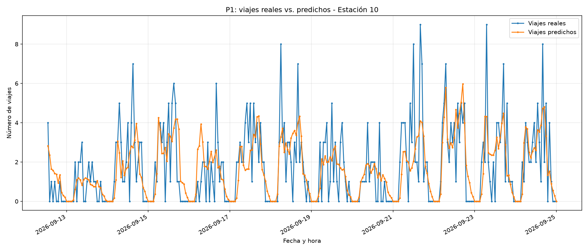

# Modelo de regresión: predicción de demanda horaria de MiBici

## 1. Objetivo

Desarrollar y evaluar un modelo de regresión capaz de predecir la cantidad de viajes de MiBici Guadalajara por estación y hora, utilizando información histórica y características temporales.

El modelo busca estimar la demanda para la siguiente hora y comparar su desempeño con un modelo baseline, como parte del proyecto MiBici MLOps.

## 2. Datos utilizados

Se utilizaron los datos procesados de viajes correspondientes al periodo de julio a septiembre de 2026.

Los archivos de entrada se encuentran en `data/processed/`:

- `viajes_2026_07.parquet`
- `viajes_2026_08.parquet`
- `viajes_2026_09.parquet`

Durante la ejecución de referencia se cargaron **1,271,079 registros de viajes** correspondientes a 470 estaciones identificadas en los datos de viajes.

Los registros se organizaron en series temporales por estación, con una frecuencia horaria, para construir las variables necesarias para el entrenamiento.

## 3. Preparación de datos e ingeniería de características

Se construyeron características temporales e históricas para representar los patrones de demanda de cada estación.

| Variable | Descripción |
|---|---|
| `hora_dia` | Hora del día correspondiente al registro. |
| `dia_semana` | Día de la semana. |
| `mes` | Mes del registro. |
| `fin_semana` | Indicador de si el registro corresponde al fin de semana. |
| `viajes_lag_1` | Cantidad de viajes de la hora anterior. |
| `viajes_lag_24` | Cantidad de viajes de la misma hora del día anterior. |
| `viajes_lag_168` | Cantidad de viajes de la misma hora de la semana anterior. |
| `promedio_24h` | Promedio histórico de viajes de las últimas 24 horas. |
| `estacion` | Identificador de la estación, tratado como variable categórica. |

La variable objetivo es `target_viajes_siguiente_hora`, que representa la cantidad de viajes que se busca predecir para la siguiente hora.

Para construir las características históricas se utilizan operaciones de desplazamiento temporal y promedios móviles. Las observaciones que no cuentan con el historial necesario para calcular estas variables se excluyen del conjunto final de modelado.

## 4. Modelo utilizado

Se implementó un modelo **Random Forest Regressor**, un algoritmo de aprendizaje supervisado que combina múltiples árboles de decisión para generar predicciones numéricas.

La configuración principal utilizada fue:

| Parámetro | Valor |
|---|---:|
| `n_estimators` | 100 |
| `max_depth` | 15 |
| `random_state` | 42 |
| `n_jobs` | -1 |

La variable categórica de estación se transforma mediante codificación one-hot para que pueda ser utilizada por el modelo.

## 5. Entrenamiento y evaluación

Los datos se dividieron cronológicamente en conjuntos de entrenamiento y prueba, utilizando aproximadamente el 80 % de las observaciones para entrenamiento y el 20 % para evaluación.

Se comparó Random Forest con un modelo baseline para determinar si el algoritmo proporciona mejores predicciones que la referencia.

### Métricas utilizadas

- **MAE (Mean Absolute Error):** mide el promedio de las diferencias absolutas entre los valores reales y las predicciones. Un valor menor indica menor error absoluto promedio.
- **RMSE (Root Mean Squared Error):** mide el error cuadrático medio expresado en las mismas unidades de la variable objetivo. Penaliza con mayor intensidad los errores grandes.

## 6. Resultados

En la ejecución evaluada se obtuvieron los siguientes resultados:

| Modelo | MAE | RMSE |
|---|---:|---:|
| Baseline | 1.412 | 2.625 |
| Random Forest | 0.981 | 1.752 |

Random Forest obtuvo un menor error que el baseline en ambas métricas.

Respecto al baseline, el MAE disminuyó aproximadamente un **30.5 %**, mientras que el RMSE disminuyó aproximadamente un **33.3 %**.

Estos resultados corresponden a la ejecución evaluada y no garantizan el mismo desempeño en periodos futuros. La evaluación debe considerar la calidad y cobertura de los datos, así como la estrategia de separación temporal.

## 7. Evaluación por estación

Además de la evaluación general, se realizó una evaluación específica para la estación identificada como `10`.

Los resultados registrados fueron:

| Métrica | Resultado |
|---|---:|
| Observaciones evaluadas | 440 |
| MAE | 1.052 |
| RMSE | 1.500 |

Esta evaluación permite observar el comportamiento del modelo en una estación específica. Sus resultados deben interpretarse considerando el número de observaciones disponibles y la representatividad del periodo evaluado.

## 8. Seguimiento de experimentos con MLflow

Se integró MLflow para registrar las métricas y facilitar el seguimiento de los experimentos de entrenamiento.

Este seguimiento permite consultar los resultados obtenidos y comparar ejecuciones del modelo.

## 9. Artefactos generados

Durante la ejecución del modelo se genera una gráfica de evaluación en la siguiente ruta:

`reports/figures/p1_regression.png`

Si la imagen está disponible y se incluye en el repositorio, puede visualizarse desde este documento mediante:



La gráfica permite analizar visualmente la relación entre los viajes reales y las predicciones generadas por el modelo.

## 10. Ejecución del modelo

Desde la raíz del repositorio, con el entorno virtual activado y las dependencias instaladas, ejecutar:

```bash
python -m mibici_mlops.modeling.train_p1_regression
```

El script carga los datos procesados, construye las características, entrena el modelo, calcula las métricas y genera los resultados de evaluación.

## 11. Consideraciones

- Los datos de entrada deben encontrarse en `data/processed/`.
- Las variables históricas requieren suficientes observaciones anteriores para su cálculo.
- La división cronológica debe mantenerse para evaluar el modelo sobre datos posteriores a los utilizados en el entrenamiento.
- Es importante verificar que las horas faltantes representen realmente periodos sin viajes y no interrupciones en la disponibilidad de los datos.
- Los resultados reportados corresponden a una ejecución específica y pueden cambiar al actualizar los datos o modificar la configuración del modelo.

## 12. Conclusión

El modelo Random Forest obtuvo mejores resultados que el baseline en la ejecución evaluada, con un MAE de 0.981 y un RMSE de 1.752.

La incorporación de variables temporales e históricas permite modelar patrones de demanda por estación y hora. El registro de métricas mediante MLflow facilita la trazabilidad y comparación de experimentos dentro del flujo de trabajo MLOps.