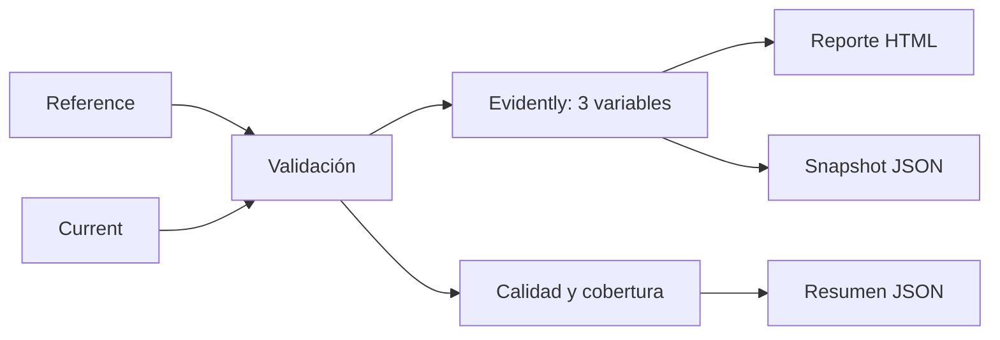

# Monitoreo de data drift para P2

## Objetivo

Este módulo compara las tres variables predictoras del clasificador P2 entre
Reference (julio–septiembre de 2026) y Current (octubre de 2026). Detecta data
drift y revisa la calidad de los datos antes de evaluar versiones del modelo.

P2 usa `alta_demanda` como proxy de demanda relativa. El reporte muestra data
drift, no demuestra concept drift ni una pérdida de desempeño del modelo.

## Datasets y configuración

| Conjunto | Archivo | Periodo | Filas |
|---|---|---|---:|
| Reference | `data/interim/p2_drift_reference.parquet` | julio–septiembre | 470 |
| Current | `data/interim/p2_drift_current.parquet` | octubre | 470 |

Se requieren exactamente las columnas `estacion`, `promedio_duracion_salida`,
`pct_viajes_matutinos` y `viajes_entrantes`. `estacion` se usa solo para
cobertura y duplicados: Evidently recibe exclusivamente las tres predictoras.

El módulo [p2_drift.py](../mibici_mlops/monitoring/p2_drift.py) usa Evidently
0.7.23, `DataDriftPreset` y `DataSummaryPreset`. Ejecuta Kolmogorov–Smirnov
(`ks`) para cada variable numérica con umbral de valor p de 0.05 y declara
drift global a partir de 50 % de variables afectadas.

Evidently 0.7 no identifica `UInt32` como numérico para KS. El módulo convierte
una copia en memoria a `float64`; los Parquet originales no se modifican.

## Arquitectura



La validación rechaza archivos inexistentes, columnas faltantes o adicionales,
tipos incorrectos, nulos e infinitos. Informa duplicados y cobertura sin fijar
umbrales arbitrarios para esas dos medidas.

## Ejecución

Con Python 3.11 y los dos Parquet disponibles en `data/interim/`:

```bash
.venv/bin/python -m pip install -r requirements.txt
.venv/bin/python -m mibici_mlops.monitoring.p2_drift monitor
```

Las salidas reproducibles son `reports/p2_evidently_drift_report.html`,
`reports/p2_evidently_snapshot.json` y `reports/p2_data_quality_summary.json`.
Se excluyen de Git; el HTML se abre directamente en un navegador.

## Resultado observado

La ejecución del 11 de noviembre de 2026 generó los tres artefactos con los
siguientes resultados de calidad: ambos conjuntos tienen 470 filas, cero
nulos, cero infinitos, cero duplicados y 470 estaciones únicas. Comparten 468
estaciones; solo Reference contiene 175 y 407, y solo Current 124 y 492. Esto
describe cobertura, no permite inferir altas o bajas de estaciones.

| Variable | Media Reference | Media Current | KS | Resultado |
|---|---:|---:|---:|---|
| `promedio_duracion_salida` | 10.78 min | 9.19 min | p = 6.85e-47 | Drift |
| `pct_viajes_matutinos` | 33.43 % | 32.59 % | p = 0.1476 | Sin drift |
| `viajes_entrantes` | 2704.42 | 1352.20 | p = 9.67e-16 | Drift |

Evidently detectó drift en 2 de 3 variables (66.67 %), por encima del criterio
global de 50 %. El cambio de `promedio_duracion_salida` debe vigilarse durante
el A/B testing porque la variable alimenta directamente a P2.

## Limitación de `viajes_entrantes`

`viajes_entrantes` es un conteo acumulado por estación. Reference cubre 92
días y Current 31, por lo que la reducción del conteo bruto no demuestra una
reducción de uso o demanda. Como contexto descriptivo, sin modificar datos ni
agregar una variable al reporte, la media diaria es 29.40 en Reference y 43.62
en Current. La tasa muestra que el test sobre conteos brutos incorpora la
duración desigual de ventanas; tampoco prueba por sí sola un aumento conductual.

## Recomendación

No se recomienda activar Continuous Training solo por este reporte. Primero se
deben comparar ambas versiones con el mismo conjunto actual y definición de
etiqueta. Si F1, ROC-AUC u otra métrica acordada empeoran junto con drift
sostenido en periodos comparables, habrá evidencia para reentrenar. En el
futuro conviene comparar ventanas de igual duración o añadir una tasa por día
como diagnóstico separado.

## Pruebas

```bash
.venv/bin/python -m pytest tests/test_p2_drift_monitoring.py -v
.venv/bin/python -m ruff check mibici_mlops/monitoring tests/test_p2_drift_monitoring.py
```

Las pruebas cubren carga, archivo inexistente, contrato de columnas, nulos,
tipos incorrectos, infinitos, exclusión de `estacion` y generación de reportes.
